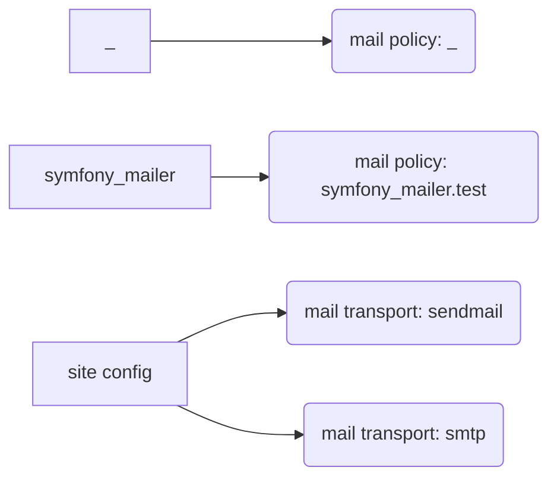

# Integrations — generated (`node .ai/scripts/cli.ts integrations --update`)

What the system exchanges with the outside and what runs on its own. The tables are generated from code and config;
write the **why**, **how it fails** and **how to test it locally** between each `notes` marker — that part is kept.

## mail policy

### _ — `mail:_`

- outbound · module _ · `config/sync/symfony_mailer.mailer_policy._.yml:1`
- config: `config/sync/symfony_mailer.mailer_policy._.yml`

<!-- notes:mail:_ -->
_Why it exists · how it fails · how to test it locally — to be written by a human._
<!-- /notes -->

### symfony_mailer.test — `mail:symfony_mailer.test`

- outbound · module symfony_mailer · `config/sync/symfony_mailer.mailer_policy.symfony_mailer.test.yml:1`
- config: `config/sync/symfony_mailer.mailer_policy.symfony_mailer.test.yml`

<!-- notes:mail:symfony_mailer.test -->
_Why it exists · how it fails · how to test it locally — to be written by a human._
<!-- /notes -->

## mail transport

### sendmail — `mail:transport:sendmail`

- outbound · module — · `config/sync/symfony_mailer.mailer_transport.sendmail.yml:1`
- config: `config/sync/symfony_mailer.mailer_transport.sendmail.yml`
- plugin sendmail

<!-- notes:mail:transport:sendmail -->
_Why it exists · how it fails · how to test it locally — to be written by a human._
<!-- /notes -->

### smtp — `mail:transport:smtp`

- outbound · module — · `config/sync/symfony_mailer.mailer_transport.smtp.yml:1`
- config: `config/sync/symfony_mailer.mailer_transport.smtp.yml`
- plugin smtp

<!-- notes:mail:transport:smtp -->
_Why it exists · how it fails · how to test it locally — to be written by a human._
<!-- /notes -->
